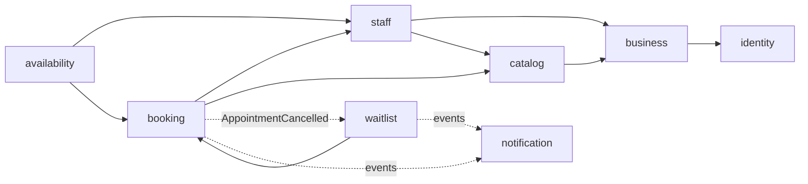
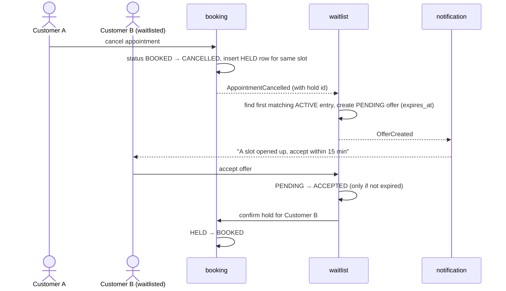

# Architecture

The backend is a **modular monolith**: a single Spring Boot application whose packages are split
into modules with explicit boundaries, verified by Spring Modulith tests.
See [ADR 0001](adr/0001-modular-monolith.md) for why this is not a set of microservices.

Base package: `io.github.miraybozdogan.appointments`

## Modules

| Module         | Responsibility                                                         |
|----------------|------------------------------------------------------------------------|
| `identity`     | Users, authentication (JWT), business memberships and roles            |
| `business`     | Businesses and their settings (time zone, offer duration)              |
| `catalog`      | Services a business offers (name, duration, price)                     |
| `staff`        | Staff members, which services they perform, working hours, time off    |
| `availability` | Computes free slots from working hours, time off and bookings (no tables) |
| `booking`      | Appointments, slot holds, the no-overlap rule, cancellation            |
| `waitlist`     | Waitlist entries, offers, offer expiry                                 |
| `notification` | In-app notifications; later published to RabbitMQ through an outbox    |

Each module exposes a small public API (a service interface and DTOs in the module's root
package). Everything else lives in an `internal` sub-package and is not accessible to other
modules.

## Dependencies

Arrows point from a module to the modules it calls. There are no cycles.

Dashed arrows are **domain events**, not calls. `booking` publishes `AppointmentCancelled`
without knowing that a waitlist exists. `waitlist` listens and starts the offer chain.
Events are recorded in Spring Modulith's event publication table in the same transaction
as the change that caused them, so a crash between "commit" and "handle event" does not
lose the event.

## Main flow: a cancelled slot is offered to the waitlist

If the customer declines or the offer expires, the waitlist moves on to the next matching
entry and the slot stays `HELD`. When no one is left, the hold is released and the slot
becomes bookable again.

## Cross-cutting rules

- **Tenancy.** Business-scoped endpoints are under `/api/businesses/{businessId}/...`.
  Every request checks that the caller is a member of that business, and every query filters
  by `business_id`. Customers can only see their own appointments, waitlist entries and offers.
- **Roles.** `CUSTOMER` (any signed-in user), `STAFF` and `OWNER` (per business, via
  `business_membership`).
- **Traceability.** Cancellation, offer creation, acceptance, decline and expiry are written to
  `audit_event`.
- **Time.** All instants are `timestamptz` in UTC. See [ADR 0004](adr/0004-time-zone-handling.md).
