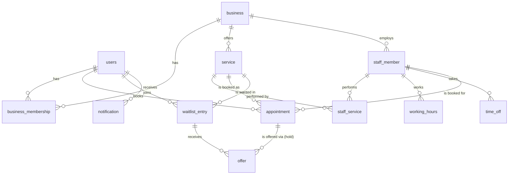
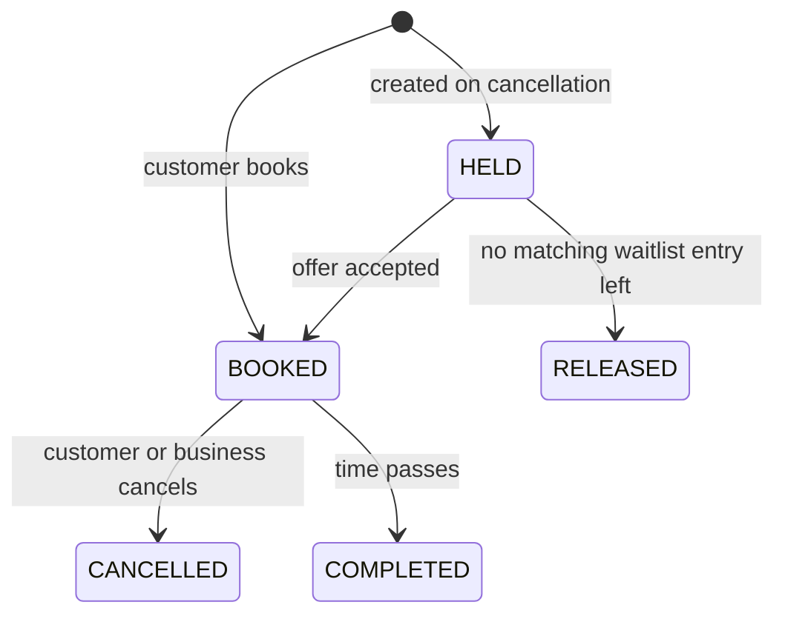
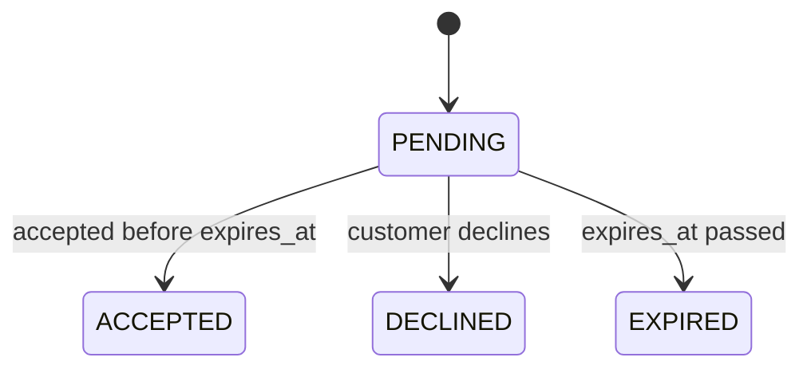
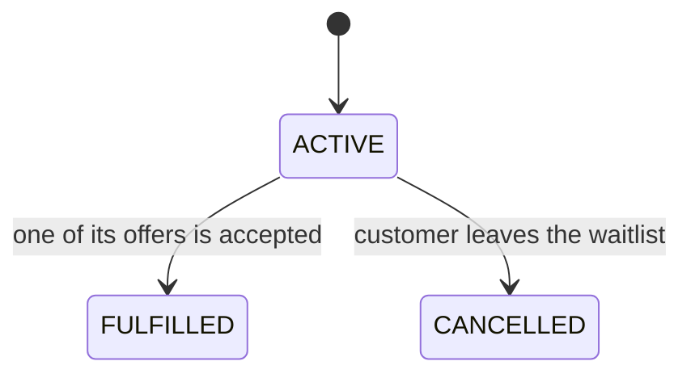

# Data model

PostgreSQL, versioned with Flyway. Primary keys are UUIDs. Every instant is a `timestamptz`
stored in UTC. Time ranges use `tstzrange` with half-open bounds `[start, end)`, so an
appointment ending at 10:00 does not overlap one starting at 10:00.

## Entity relationships



## Tables

### Identity and business

| Table                 | Key columns                                                                          |
|-----------------------|--------------------------------------------------------------------------------------|
| `users`               | `id`, `email` (unique), `password_hash`, `full_name`, `phone`                         |
| `business`            | `id`, `name`, `slug` (unique), `timezone` (IANA, e.g. `Europe/Istanbul`), `offer_ttl_minutes` (default 15) |
| `business_membership` | `user_id`, `business_id`, `role` (`OWNER` / `STAFF`). PK `(user_id, business_id)`     |

Customers are global users with no membership row. They can book at any business.

### Catalog and staff

| Table           | Key columns                                                                     |
|-----------------|---------------------------------------------------------------------------------|
| `service`       | `id`, `business_id`, `name`, `duration_minutes`, `price_cents`, `active`         |
| `staff_member`  | `id`, `business_id`, `user_id` (nullable), `display_name`, `active`              |
| `staff_service` | `staff_id`, `service_id`. PK `(staff_id, service_id)`                            |
| `working_hours` | `staff_id`, `day_of_week` (1–7), `start_local` `time`, `end_local` `time`         |
| `time_off`      | `id`, `staff_id`, `period` `tstzrange`                                           |

Service names are unique within a business, ignoring case (unique index on
`(business_id, lower(name))`).

`working_hours` is stored in the business's **local time**, not UTC (see ADR 0004).
Intervals of one staff member on the same day must not overlap (exclusion constraint
`working_hours_no_overlap`). Shifts that cross midnight are not supported.

### Booking

`appointment`: `id`, `business_id`, `staff_id`, `service_id`, `customer_id` (nullable),
`start_at`, `end_at`, `period` (generated from `start_at`/`end_at`, see ADR 0005), `status`,
`version`, `created_at`, `cancelled_at`

Appointments start on a 15-minute grid in the business's local time and must fit inside one
working interval of the staff member.

```sql
CREATE EXTENSION IF NOT EXISTS btree_gist;

ALTER TABLE appointment
  ADD CONSTRAINT appointment_no_overlap
  EXCLUDE USING gist (staff_id WITH =, period WITH &&)
  WHERE (status IN ('BOOKED', 'HELD'));

ALTER TABLE appointment
  ADD CONSTRAINT appointment_customer_matches_status
  CHECK ((status IN ('HELD', 'RELEASED')) = (customer_id IS NULL));
```

A `HELD` row reserves a slot while it is being offered to the waitlist. It belongs to no
customer yet, but it takes part in the no-overlap constraint, so nobody else can book it.

### Waitlist

`waitlist_entry`: `id`, `business_id`, `customer_id`, `service_id`, `preferred_staff_id`
(nullable = any staff), `desired_window` `tstzrange`, `status`, `created_at`

- At most one `ACTIVE` entry per `(business_id, customer_id, service_id)` (partial unique index).

`offer`: `id`, `waitlist_entry_id`, `hold_appointment_id`, `status`, `offered_at`,
`expires_at`, `responded_at`

- At most one `PENDING` offer per hold (partial unique index on `hold_appointment_id`).
- The same entry is never offered the same hold twice (unique `(hold_appointment_id, waitlist_entry_id)`).
- Index on `expires_at` where `status = 'PENDING'` for the expiry job.

**Matching rule.** For a hold, the next candidate is the oldest (`created_at`, then `id`)
`ACTIVE` entry where:

1. the business and the service are the same as the cancelled appointment,
2. `preferred_staff_id` is null or equals the hold's staff member,
3. `desired_window @> period`,
4. the entry has not already been offered this hold.

### Notifications and audit

| Table          | Key columns                                                                                  |
|----------------|----------------------------------------------------------------------------------------------|
| `notification` | `id`, `recipient_id`, `type`, `payload` `jsonb`, `dedup_key` (unique), `created_at`, `read_at` |
| `audit_event`  | `id`, `business_id`, `aggregate_type`, `aggregate_id`, `event_type`, `payload` `jsonb`, `occurred_at` |

`dedup_key` makes notification creation idempotent: handling the same event twice does not
create a second notification.

## State machines

### Appointment



### Offer



Every transition out of `PENDING` is a conditional update
(`... WHERE id = ? AND status = 'PENDING'`). If two transitions race, only one of them
updates a row, and the other one fails.

### Waitlist entry



A declined or expired offer leaves the entry `ACTIVE`, so the customer can still receive
offers for other slots.
